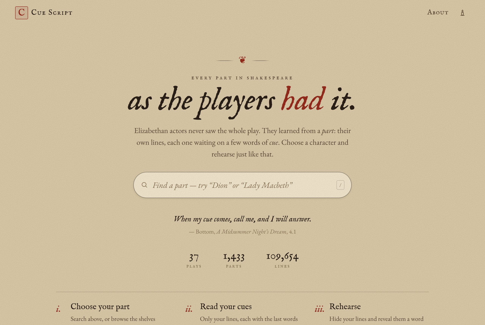
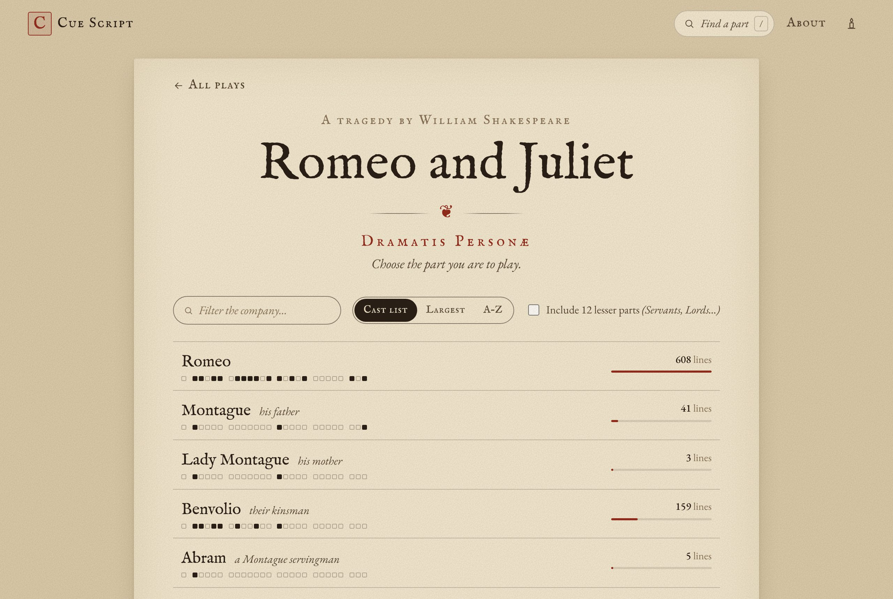
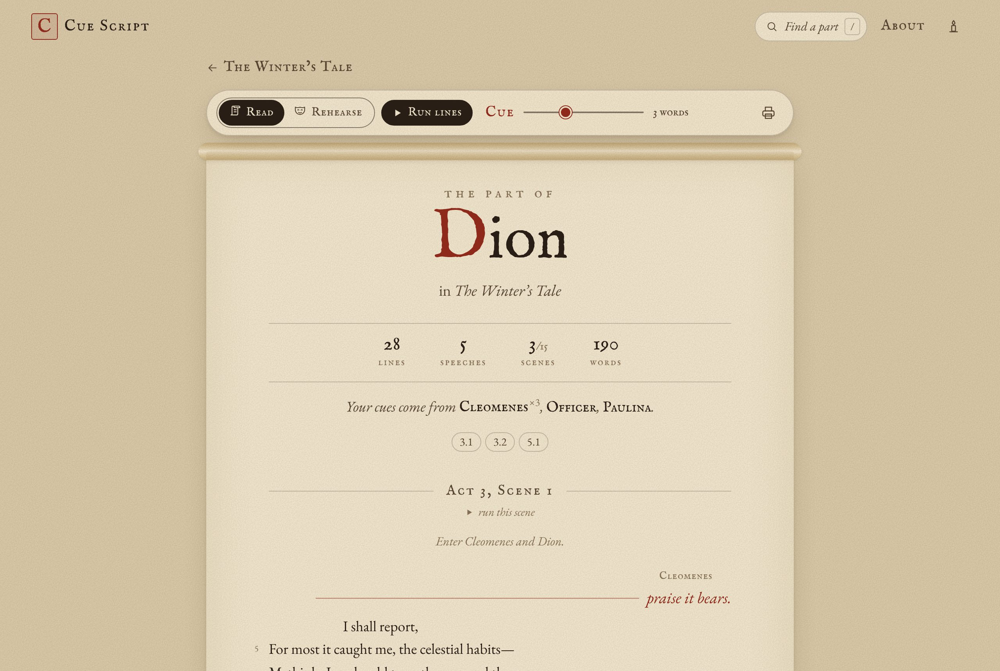
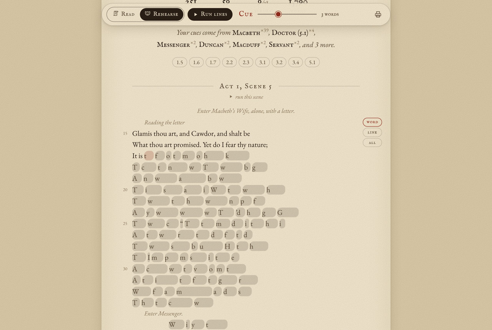
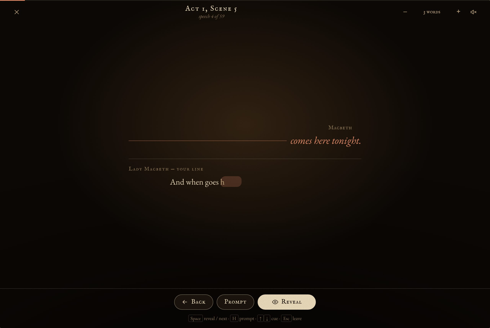
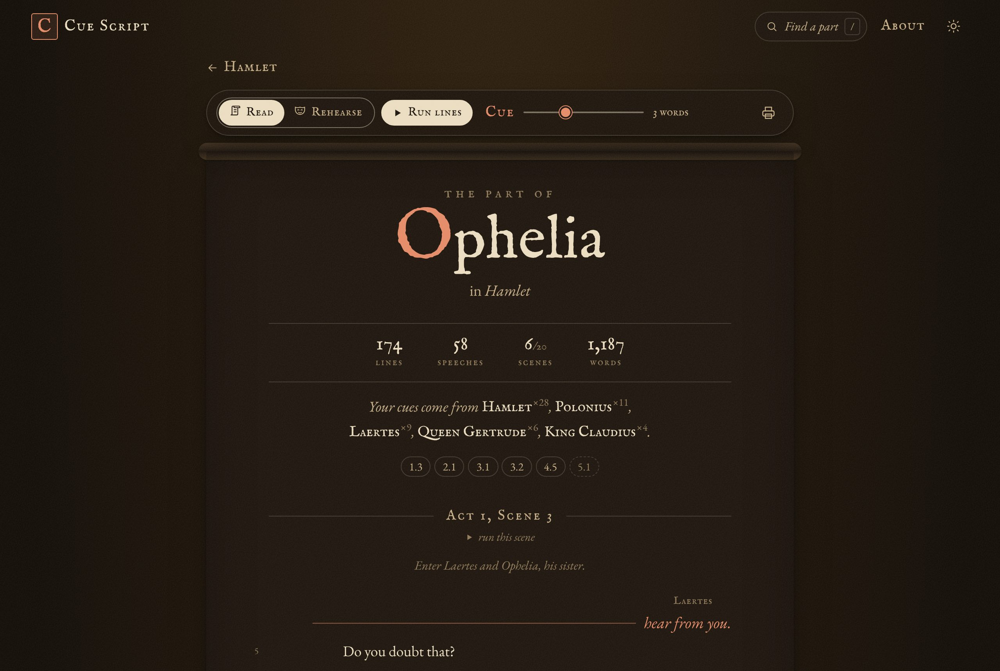
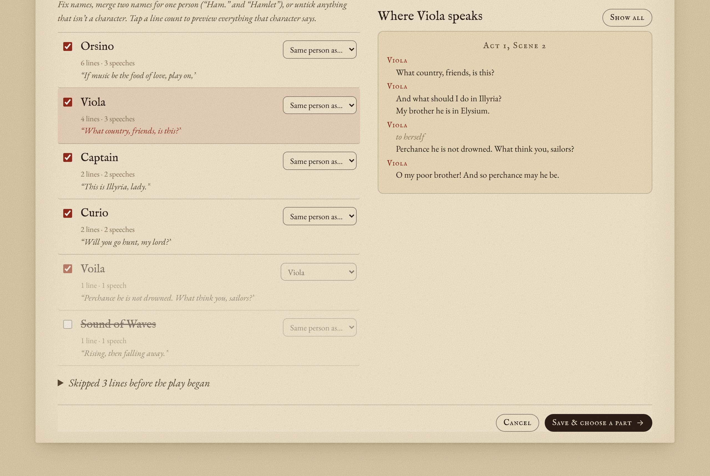

# Cue Script

**Every part in Shakespeare, as the players had it.**

Elizabethan actors never received a whole play. Each got a *part*: their own
speeches, each preceded by a *cue* (the last few words of the speech before).
Cue Script makes that part for any of the 1,433 speaking roles in 37 plays, then
helps you learn it.

- **Read**: your lines and cues, as a parchment roll. A slider sets the cue
  length, from the authentic one word to the whole preceding speech.
- **Rehearse**: your lines are inked over. Uncover them a word, a line, or a
  speech at a time, with optional first-letter hints.
- **Run lines**: a candle-lit stage that steps through cue → your line, and can
  read each cue aloud (each scene partner gets their own voice).
- **Print**: clean, ink-only sides for the rehearsal room.
- Daylight and candlelight themes, keyboard shortcuts, and a phone-friendly layout.
- **Your scripts**: bring your own play (Word, PDF, plain text or TEI XML),
  check the cast, and get cue scripts for every part. A director can send the
  cast a small `.cuescript` production file so everyone rehearses from the same
  version. Everything stays in the browser.

| | |
| --- | --- |
|  |  |
|  |  |
|  |  |

## Getting started

```bash
npm install
npm run dev      # first run fetches the Folger TEI texts and builds the play data
```

Other scripts:

| command          | what it does                                                      |
| ---------------- | ----------------------------------------------------------------- |
| `npm run data`   | regenerate `src/lib/data/` from the TEI texts (pinned commit)     |
| `npm test`       | unit tests: cue builder, script/Word/TEI parsers, corrections     |
| `npm run check`  | type-check                                                        |
| `npm run build`  | prerender the whole site (≈1,500 pages) to `build/`               |

Pushing to `main` deploys to GitHub Pages through `.github/workflows/deploy.yml`.
In the repo settings, set **Pages → Source** to **GitHub Actions**.

## How it fits together

```
TEI XML ──► source adapter ──► normalized Play JSON ──► buildPart() ──► UI
             src/lib/sources/   src/lib/play/types.ts    src/lib/play/part.ts
```

- **`src/lib/play/types.ts`**: the normalized `Play` format: scenes, speeches,
  lines (with Folger line numbers, verse/prose, shared-line fragments, songs),
  stage directions, and characters with stats and on-stage presence. Everything
  downstream sees only this format.
- **`src/lib/sources/folger-tei.ts`**: the adapter for Folger TEI Simple. It runs
  against any DOM (`DOMParser` in the browser, `@xmldom/xmldom` in Node).
- **`src/lib/play/part.ts`**: a pure function that turns a `Play` and a character
  into the part: cues (the whole preceding speech is kept, so the UI can trim it
  freely), the character's speeches, and the stage directions that involve them.
  It also produces the rehearsal sequence.
- **Routes**: `/` (search and shelves), `/[play]` (dramatis personae),
  `/[play]/[character]` (the cue script). All pages are prerendered.

### Your scripts (uploads)



```
.txt / paste ─► linesFromText ─┐
.docx ───────► linesFromDocx ──┼─► ScriptLine[] ─► parseScript ─┐
.pdf ────────► linesFromPdf ───┘                                ├─► Play ─► applyCorrections ─► Play
.xml (TEI) ──────────────────────► parseFolgerTei ──────────────┘          (cast review)
```

- **`src/lib/sources/script.ts`** detects the speaker layout: inline
  (`HAMLET. To be…`, `Ham. To be…`, `Hamlet: …`) or names on their own line. It
  also finds acts, scenes and prologues, stage directions (italics, brackets,
  `Enter`/`Exit`), the dramatis personae (used to expand abbreviations such as
  `Ham.` → Hamlet), and Project Gutenberg headers.
- **`docx.ts`** reads paragraph styles ("Character", "Dialogue",
  "Parenthetical"…), italics, centring and capitals, and turns two-column
  name | speech tables into speeches. **`pdf.ts`** (pdf.js, loaded only when
  needed) rebuilds lines from text positions, re-joins wrapped prose, and drops
  page numbers, running headers and margin line numbers.
- **`src/lib/play/corrections.ts`**: the cast review never edits the parsed
  play. It stores corrections (rename, merge, "not a character", title) that
  are re-applied on top. A future **full script editor** can add new correction
  kinds (split a speech, move a line, add a scene break) without touching the
  parsers or the views.
- **`src/lib/library.ts`** keeps scripts in IndexedDB (in memory if the browser
  forbids storage). It also reads and writes `.cuescript` production files,
  which hold the source, corrections and finished play. Opening a newer file
  with the same id updates the copy in place.
- Routes: `/my` (library), `/my/new`, `/my/edit?id=`, `/my/play?id=`,
  `/my/part?id=&c=`. They render client-side (`ssr = false`), so the site
  stays fully static.

## Credits & licence of the texts

The play texts are from [Folger Shakespeare](https://www.folger.edu/explore/shakespeares-works/),
ed. Barbara A. Mowat & Paul Werstine, © Folger Shakespeare Library. They are
licensed [CC BY-NC 3.0](https://creativecommons.org/licenses/by-nc/3.0/), so the
site must stay non-commercial and keep the attribution. The TEI Simple files
come through [DraCor](https://dracor.org/shake). The idea comes from the Folger's
[parts tool](https://www.folgerdigitaltexts.org/).
